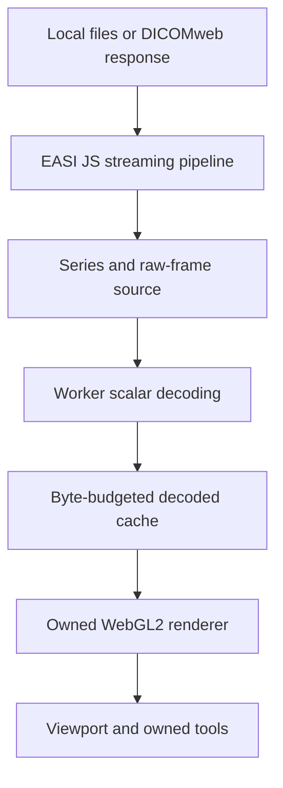

# EASI View architecture

EASI View owns its rendering engine, runtime, tools, and application. EASI JS
is its DICOM data foundation. The initial implementation uses browser APIs
directly, with no dependency on another viewer engine.

## Boundaries

`src/data` parses actual DICOM bytes through EASI's builder and normalizes a
deliberately bounded native monochrome profile. Synthetic demos enter through
the same DICOM pipeline as imports. Original stored samples are retained with
scaling, presentation settings and physical geometry; RGBA is a display result.

`src/runtime` owns decoding and decoded-frame cache lifetimes. A frame source
decodes the requested frame lazily. Workers receive frame-sized buffers, rather
than copies of the whole study. Cancellation prevents stale decoded results
from replacing the selected frame. Input and cache limits are explicit.

`src/render` implements scalar textures, display shaders, viewport coordinate
transforms and a CPU display reference. Window changes reuse the texture.
Patient-plane pixel spacing affects aspect ratio and distance measurement.
The CPU path makes rendering usable without WebGL2 and supplies independently
testable display math. GPU resource deletion is part of renderer disposal.

`src/ui` owns series navigation, input lifecycle, interaction tools and cine.
Measurements remain in image coordinates so viewport transforms preserve them.
Selecting a new input cancels previous loading. Hiding the page pauses cine.

## Contract

A frame contains dimensions, an original scalar typed array, signedness already
interpreted, slope/intercept, photometric interpretation, window defaults and
VOI function. Geometry uses DICOM row/column spacing, orientation and position.
Display transforms must not overwrite source samples or apply rescale twice.

The initial frame source lives in this project. Reusable raw-frame API work can
later move into EASI JS as an additive API once the contract is proven; the
published EASI JS 1.0.0 package is not modified by this project.

## Performance promises to verify

Prioritize the selected frame; do not decode a complete stack before drawing.
Bound encoded input and decoded cache independently. GPU memory is a separate
budget. Cancellation, rapid scrolling, repeated open/close and GPU context loss
need measurable acceptance checks.

This alpha materializes encoded Pixel Data within its input cap. Progressive
instance callbacks can make the first image available before a multipart study
finishes, but a frame is only usable after its required bytes arrive. The current
design does not promise constant memory for arbitrary studies or volume work.

## Later engine work

Multi-viewport rendering and synchronization precede reconstruction. MPR needs
correct volume grouping, per-frame geometry, patient coordinates and interpolation
tests. An owned volume ray marcher follows that foundation. Large volumes need
an explicit bricking/out-of-core strategy; streaming parsing alone does not solve
volume residency. Codec providers are separate, replaceable components with their
own licensing and correctness matrices.
