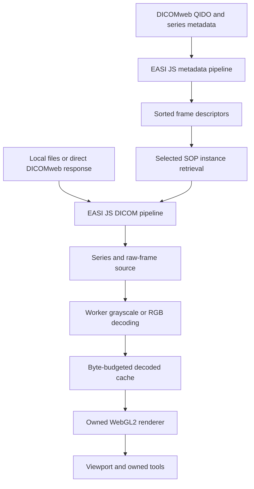

# EASI View architecture

EASI View owns its rendering engine, runtime, tools, and application. EASI JS
is its DICOM data foundation. The initial implementation uses browser APIs
directly, with no dependency on another viewer engine.

## Boundaries

`src/data` parses actual DICOM bytes through EASI's builder and normalizes a
deliberately bounded native grayscale/unsigned 8-bit RGB profile. `DicomWebClient` uses EASI's
metadata pipeline for QIDO results and WADO series metadata, with explicit UID,
schema, paging and byte guards. `archive-source.js` groups compatible metadata
into spatially sorted descriptors before any image instance is requested.
`getFrame()` retrieves only the selected SOP instance and reuses the same bounded
native-response parser as direct URL loads. Retrieved Study/Series/SOP identity,
dimensions, frame count and normalized geometry must match the descriptor;
the actual native pixel/profile guards remain authoritative. Synthetic demos enter through
the same DICOM pipeline as imports. Original stored samples are retained with
scaling, presentation settings and physical geometry; RGBA is a display result.

`src/runtime` owns decoding and decoded-frame cache lifetimes. A frame source
decodes the requested frame lazily. Workers receive frame-sized buffers, rather
than copies of the whole study. Cancellation prevents stale decoded results
from replacing the selected frame. Input and cache limits are explicit.

`src/render` implements scalar and RGB textures, display shaders, viewport coordinate
transforms and a CPU display reference. Window changes reuse the texture.
Patient-plane pixel spacing affects aspect ratio and distance measurement.
The CPU path makes rendering usable without WebGL2 and supplies independently
testable display math. GPU resource deletion is part of renderer disposal.

`src/ui` owns series navigation, input lifecycle, interaction tools and cine.
Measurements remain in image coordinates so viewport transforms preserve them.
Selecting a new input cancels previous loading. Hiding the page pauses cine.

`src/integration` exposes the same runtime through `createViewer(container,
options)`. One registered viewer owns each mounted container. A Shadow DOM
boundary scopes its stylesheet and markup, and keyboard handling is bound to the
viewer rather than the host document. Host options choose brand, supported color
tokens, visible chrome and optional synthetic startup data. Source/frame controls
and operational events let the host retain ownership of its worklist and product
navigation. Operational events and `getState()` return no pixel arrays or patient
identifiers. Explicit study/series search calls return requested archive records
to the host, including identifiers; their handling belongs to that application.

Disposal cancels input and frame work, releases workers/cache/GPU ownership,
disconnects observers and listeners, and removes the mount registration. The
host must call it on component unmount; removing DOM alone is not the ownership
contract. Multiple containers have independent viewers. See
[EMBEDDING.md](EMBEDDING.md) for the SDK and CSP contract.

## Local catalog and patient sessions

`src/catalog/metadata.js` composes an EASI JS file-stream/selection pipeline for
bounded scalar navigation metadata. It stops before image values in an ordered
dataset, without invoking a decoder or retaining pixel arrays. `LocalCatalog`
holds normalized patient/study/series/instance metadata and private File
references. Imports commit atomically and add to the session catalog; patient
identity scopes and conflicting UID variants remain explicit. The index is
bounded to 30,000 files, a 2 MiB scan per file and 64 MiB metadata accounting.
An indexed object remains unverified for pixel viewing.

`LocalLibraryPanel` renders patient search, the study timeline and explicit
series/comparison choices from catalog snapshots. It does not read files or
decode images. Selecting a series passes only that series' File references to
the existing image loader and shared workspace. Catalog indexing and pixel
display are separate transactions: failed image preparation leaves indexed
records discoverable and restores the previous display. SDK `importLocalFiles`
uses this additive workflow; legacy `openFiles` retains source replacement.

`src/integration/LocalWorkingSet.js` plans bounded loaded-series retention.
Selected catalog series groups are protected; recent inactive groups are kept
within stack, frame and encoded-byte limits. It counts shared backing buffers
once and does not mutate or dispose sources. The UI releases evicted groups only
after the replacement view commits, preserving rollback and the full metadata
catalog. Reopening an evicted series rereads its original files.

`src/integration/LocalPatientSession.js` holds opaque patient/study references
and explicit current/comparison roles. Plans must select studies belonging to
the same associated patient before a guarded pane commit. Its
`LocalAnnotationSessions` caches up to 8 MiB of local patient measurement
documents, subject also to the active annotation store's own limits. Switching
patients restores only that patient's document and clears undo/redo history;
external annotation documents never enter this cache. Other derived-object
state is cleared on patient changes, rather than retained as a patient archive.

Catalog metadata is exposed through explicit `getLocalCatalog()` access;
ordinary library state/events contain counts and opaque references. File
references, associations and cached measurements are memory-only and released
on cleanup. These modules use EASI JS's public selection and image pipelines;
the independently packaged core remains unchanged. See
[LOCAL_LIBRARY.md](LOCAL_LIBRARY.md) for identity rules, lifetime and exact
workflow limits.

## Contract

Classic XA uses the owned scalar renderer with a separate source-profile gate.
It accepts native unsigned MONOCHROME2 frames, explicit fixed cine timing, and
absent or inactive (`NONE`) subtraction operations. Pixel Intensity Relationship
and its sign describe the acquisition; they do not trigger a display inversion
or logarithmic transform. Active subtraction, display shutters, LUT-dependent
presentation and enhanced XA remain outside this profile. Archive servers may
transcode stored JPEG images to the native format before EASI parses them; this
does not add a browser JPEG decoder.

A frame contains dimensions, an original scalar or RGB typed array, signedness already
interpreted, slope/intercept, photometric interpretation, window defaults and
VOI function. Geometry uses DICOM row/column spacing, orientation and position.
Display transforms must not overwrite source samples or apply rescale twice.

Native RGB frames use a canonical interleaved `Uint8Array` with three channels
per pixel, `photometric: "RGB"`, and null scalar range/window. The worker
interleaves planar source frames when needed and preserves the original
channel bytes. Rendering uses RGB textures or the CPU RGB reference directly;
grayscale rescale/window/padding and inversion are not color transformations.
The encoded and decoded cache budgets count actual three-channel byte lengths.

The initial frame source lives in this project. Reusable raw-frame API work can
later move into EASI JS as an additive API once the contract is proven; the
published EASI JS 1.0.0 package is not modified by this project.

## Performance promises to verify

`src/runtime/performance.js` records bounded, sanitized observations using a
relative monotonic clock. Source, archive and UI intervals distinguish metadata
processing, overlapping streamed parsing, queued decode and accepted draw
submission. The inspector reads recent completions; the host snapshot API
computes retained-window success-only median/p95 values. Observation callbacks
isolate exceptions and do not await returned promises; disposal stops recording
and clears history.
Tracked resource counts include source sessions retained during rollback. See
[PERFORMANCE.md](PERFORMANCE.md) for exact boundaries and controlled baseline
conditions; these counts exclude complete process memory and GPU allocations.

Prioritize the selected frame; do not decode a complete stack before drawing.
Bound encoded input and decoded cache independently. GPU memory is a separate
budget. Cancellation, rapid scrolling, repeated open/close and GPU context loss
need measurable acceptance checks.

This alpha materializes encoded Pixel Data within its input cap. Progressive
instance callbacks can make the first image available before a multipart study
finishes, but a frame is only usable after its required bytes arrive. The current
design does not promise constant memory for arbitrary studies or volume work.

Archive loading separates metadata residency from pixel residency. The selected
frame's complete DICOM instance is retrieved, parsed and checked before decoding;
no neighbor is speculatively requested. A multiframe instance brings all of its
encoded frames together, but the decoder receives only the selected frame.
The archive session has independent 64 MiB encoded-instance and 64 MiB decoded-frame
LRUs. Descriptors retain no encoded byte references, so eviction releases cache
ownership. An active instance larger than the encoded budget is used transiently
within the 256 MiB instance response cap, then is not kept in that cache.
New frame requests abort superseded fetch, stream and worker work; disposal
cancels outstanding operations and releases session ownership.

Metadata responses are bounded at 8 MiB, an opened series at 10,000 descriptors
and an instance at 4,096 frames. Server-provided `BulkDataURI` is never followed.
Metadata JSON is collected within the 8 MiB cap, structurally validated and
canonicalized before EASI parsing so attribute property order does not change
values. Inline Pixel Data is rejected before parsing. EASI JS's current JSON
adapter can materialize permitted non-pixel `InlineBinary` within the metadata
input cap, so the cap is a received-byte bound rather than a complete heap limit.
The metadata text/schema check and EASI instance model also need memory.
Cached samples, the visible frame, parser buffers, worker transfers and GPU
textures are distinct allocations. Source replacement can overlap new work
with the previous source retained for rollback.

The host configures the DICOMweb base URL and request-header object or async
supplier. Browser credentials default to `omit`; optional `same-origin` or
`include` modes belong to the host's deployment. Connection settings stay in
memory, with no sign-in service or credential persistence. Redirects are rejected
and browser CORS/HTTPS rules apply. See [DICOMWEB.md](DICOMWEB.md).

## Advanced engine boundaries

Multi-viewport rendering/synchronization and bounded reconstruction share exact source descriptors. MPR validates affine volume grouping and preserves per-frame patient coordinates; parallel-ray reconstruction and explicit fusion produce separate derived values. Large volumes need
an explicit bricking/out-of-core strategy; streaming parsing alone does not solve
volume residency. Codec providers are separate, replaceable components with their
own licensing and correctness matrices.

Compressed frames retain the EASI-parsed encoded allocation plus a bounded
fragment index. Only a selected frame is assembled/transferred. The owned
worker dispatches RLE, strict JPEG Baseline or a bounded C ABI WASM provider;
scalar stored samples and decoded RGB stay separate from presentation.
The dcmjs toolkit is build/test-only. See [COMPRESSED.md](COMPRESSED.md).

`src/derived` holds exact-grid masks and restricted reported/presentation documents. The UI uses a separate budgeted Canvas/SVG layer and a shallow source-scoped GSPS display wrapper; original samples remain authoritative.

`src/enterprise` and the integration controller use trusted host adapters, a fixed archive and explicit reference-only contexts. Metadata/pixel preparation precedes a guarded pane commit. A synchronous acceptance point transfers new source ownership; rollback completes before staging is released. Logout/provider changes cannot restore old protected snapshots. The backend authorizes every resource request.

`src/specialties` uses separately gated native/metadata readers and quantitative models. Its local research workspace owns dose/subtraction buffers and declared timeline/layout/tile-index outputs separately from ordinary2D sources. Byte budgets account for replacement staging and rollback. These modules do not imply complete specialty viewer or clinical interchange support.

## Opening and session ownership

`LocalOpenSelection` holds disposable private File references and a bounded EASI
metadata preview. `OpenWorkflow` stages local/remote selections with cancellation
and capability-aware criteria; its explicit Add callbacks admit records.
`SourceRegistry` owns independent stable authenticated clients and bounded private
patient-search evidence. `SessionCatalog` holds only whitelisted metadata and
source-qualified opaque provenance, separate from file grants and pixel caches.
`SessionLibraryPanel` navigates admitted patients/studies/series without querying
sources. The engine prepares and validates selected frames before committing
patient roles, view transforms, annotation documents and pane assignments.
Remote metadata and retrieved instances are checked against the selected patient.
Legacy additive local APIs bridge into the same session navigation; replacement
APIs detach the active session identity. See [OPENING.md](OPENING.md).
